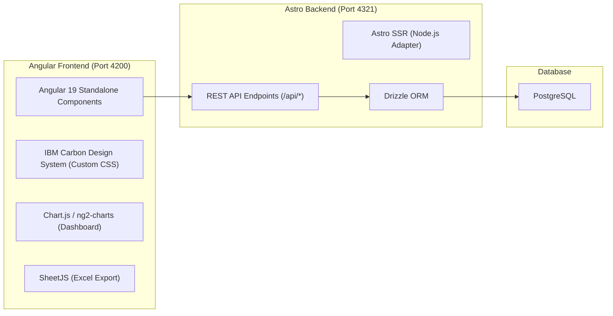
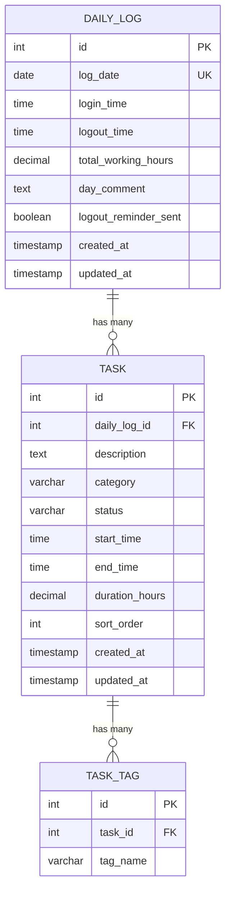

# Corporate Developer Task Logger — Project Plan

## Project Description

A **Corporate Software Developer Task Logger** designed for developers to log their daily work activities, track time, and generate reports. The application uses an **Astro** backend (SSR mode with REST API endpoints) and an **Angular** frontend styled with the **IBM Carbon Design System**.

The system allows a developer to record their daily login/logout times, log multiple tasks throughout the day (each with a category, status, description, tags, and time range), and automatically calculates total working hours. It supports generating and downloading Daily, Weekly, Monthly, Category-wise, and Project-wise reports in Excel format. It also includes a dashboard with analytics charts and a dark mode toggle.

---

## Architecture Overview

## Tech Stack

| Layer | Technology | Why |
| ------- | ----------- | ----- |
| Frontend Framework | **Angular 19** (standalone components) | As requested |
| Styling | **Custom CSS** following IBM Carbon Design tokens | From DESIGN-ibm.md |
| Font | **IBM Plex Sans** (Google Fonts) | IBM Carbon spec |
| Charts | **Chart.js + ng2-charts** | Lightweight, works well with Angular |
| Excel Export | **SheetJS (xlsx)** | Client-side Excel generation |
| Backend Framework | **Astro 5** (SSR mode) | As requested |
| Server Adapter | **@astrojs/node** | Enables SSR + API routes |
| ORM | **Drizzle ORM** | Type-safe, lightweight, great with Astro |
| Database | **PostgreSQL** | As selected |
| DB Driver | **pg** (node-postgres) | Standard PostgreSQL driver |

## Database Schema

### Table Details

**DAILY_LOG**

- One record per day
- `log_date` is unique — only one log per day
- `total_working_hours` auto-calculated from logout − login time
- `day_comment` — overall comment about the day's work
- `logout_reminder_sent` — tracks if reminder was sent

**TASK**

- Multiple tasks per daily log
- `category` enum: `Logs Checking`, `Bug Fixing`, `API Development`, `Database Work`, `Code Review`, `Deployment`, `Testing`, `Documentation`, `Meetings`, `Support`, `Production Issue`
- `status` enum: `In Progress`, `Pending`, `Completed`
- `duration_hours` auto-calculated from end_time − start_time
- `sort_order` for ordering tasks within a day

**TASK_TAG**

- Many-to-many relationship between tasks and tags
- Predefined tags: `Production`, `UAT`, `Development`, `Testing`, `Checking`, `Log`
- Users can also add custom tags

## API Endpoints

| Method | Endpoint | Description |
| -------- | ---------- | ------------- |
| **Daily Logs** | | |
| GET | `/api/daily-logs` | List all daily logs (with pagination & date range filter) |
| GET | `/api/daily-logs/:id` | Get a specific daily log with its tasks |
| GET | `/api/daily-logs/by-date/:date` | Get daily log by date (YYYY-MM-DD) |
| POST | `/api/daily-logs` | Create a new daily log |
| PUT | `/api/daily-logs/:id` | Update a daily log (login/logout time, comment) |
| DELETE | `/api/daily-logs/:id` | Delete a daily log |
| **Tasks** | | |
| GET | `/api/daily-logs/:logId/tasks` | List all tasks for a daily log |
| POST | `/api/daily-logs/:logId/tasks` | Add a task to a daily log |
| PUT | `/api/tasks/:id` | Update a task |
| DELETE | `/api/tasks/:id` | Delete a task |
| **Reports** | | |
| GET | `/api/reports/daily?date=YYYY-MM-DD` | Daily work report |
| GET | `/api/reports/weekly?date=YYYY-MM-DD` | Weekly report (week containing that date) |
| GET | `/api/reports/monthly?year=YYYY&month=MM` | Monthly report |
| GET | `/api/reports/category?from=DATE&to=DATE` | Category-wise time breakdown |
| GET | `/api/reports/project?from=DATE&to=DATE` | Project/tag-wise time breakdown |
| **Dashboard** | | |
| GET | `/api/dashboard/summary` | Dashboard summary stats |
| GET | `/api/dashboard/trends?days=30` | Working hours trend data |
| GET | `/api/dashboard/category-distribution?from=&to=` | Category distribution for charts |
| **Reminders** | | |
| GET | `/api/reminders/check` | Check for missed login/logout |

## Frontend Pages & Components

### Pages

| Route | Page | Description |
| ------- | ------ | ------------- |
| `/` | **Dashboard** | Analytics overview with charts |
| `/daily-log` | **Daily Log** | Today's log entry (login/logout + tasks) |
| `/daily-log/:date` | **Daily Log by Date** | View/edit log for a specific date |
| `/history` | **History** | List of all past daily logs with search/filter |
| `/reports` | **Reports** | Report generation and Excel download |

### Key Components

| Component | Description |
| ----------- | ------------- |
| `AppShellComponent` | Top nav + sidebar layout following Carbon nav pattern |
| `DailyLogFormComponent` | Login/logout time + day comment form |
| `TaskFormComponent` | Individual task entry form (category, status, times, description, tags) |
| `TaskListComponent` | List of tasks for the current day |
| `TaskCardComponent` | Single task display card |
| `TagInputComponent` | Tag input with predefined suggestions + custom tags |
| `TimePickerComponent` | Time picker input following Carbon styling |
| `DashboardComponent` | Charts and summary statistics |
| `CategoryChartComponent` | Pie/donut chart for category distribution |
| `TrendChartComponent` | Line chart for working hours trend |
| `ReportViewComponent` | Report display with date range selection |
| `ReportTableComponent` | Tabular data display for reports |
| `CalendarMiniComponent` | Small calendar for date navigation |
| `ReminderBannerComponent` | Top banner for missed login/logout alerts |
| `DarkModeToggleComponent` | Theme toggle switch in the nav bar |
| `ExcelExportService` | Service to generate and download Excel files |

## Design Implementation

> [!IMPORTANT]
> All styling follows the IBM Carbon Design System tokens from DESIGN-ibm.md.

### Key Design Decisions

- **CSS Custom Properties** for all Carbon design tokens (colors, spacing, typography, radii)
- **0px border-radius** everywhere — flat-square aesthetic
- **IBM Plex Sans** at weight 300 for display, 400 for body, 600 for emphasis
- **letter-spacing: 0.16px** on all body text
- **1px hairline borders** for card elevation (no shadows)
- **IBM Blue (#0f62fe)** as the only accent color
- **Dark Mode**: Carbon Gray-100 theme toggle

### Dark Mode Tokens

When dark mode is active, CSS custom properties swap to:

- Canvas: `#161616` → Inverse Canvas
- Surface-1: `#262626` → Inverse Surface-1
- Ink: `#f4f4f4` → Inverse Ink
- Hairline: `#393939`
- Primary stays `#0f62fe`

---

## To-Do Task List

### Phase 1: Project Setup & Foundation

- [ ] **1.1** Initialize Angular 19 project with standalone components
- [ ] **1.2** Initialize Astro 5 project with Node.js SSR adapter
- [ ] **1.3** Set up PostgreSQL database and create schema (Drizzle ORM migrations)
- [ ] **1.4** Configure IBM Plex Sans font and CSS custom properties for Carbon design tokens
- [ ] **1.5** Create the app shell layout (top nav, sidebar, content area) with Carbon styling
- [ ] **1.6** Set up Angular routing for all pages
- [ ] **1.7** Set up Astro API route structure

### Phase 2: Core Backend — Daily Logs & Tasks

- [ ] **2.1** Implement Drizzle schema (daily_log, task, task_tag tables)
- [ ] **2.2** Create CRUD API endpoints for daily logs
- [ ] **2.3** Create CRUD API endpoints for tasks (nested under daily logs)
- [ ] **2.4** Create task tags API (add/remove tags)
- [ ] **2.5** Implement auto-calculation of total working hours (logout − login)
- [ ] **2.6** Implement auto-calculation of task duration (end − start)
- [ ] **2.7** Add validation (one log per day, required fields, time range checks)

### Phase 3: Core Frontend — Daily Log Page

- [ ] **3.1** Build the Daily Log page layout
- [ ] **3.2** Create Login/Logout time input form with Carbon-styled time pickers
- [ ] **3.3** Create Task entry form (description, category dropdown, status dropdown, time pickers)
- [ ] **3.4** Create Tag input component with predefined suggestions
- [ ] **3.5** Build task list display with task cards
- [ ] **3.6** Add "Add Task" / "Edit Task" / "Delete Task" functionality
- [ ] **3.7** Display auto-calculated total working hours and task durations
- [ ] **3.8** Add day comment text area
- [ ] **3.9** Wire up all Angular services to backend API

### Phase 4: History & Navigation

- [ ] **4.1** Build History page with list of past daily logs
- [ ] **4.2** Add date range filter and search
- [ ] **4.3** Add mini calendar for date navigation
- [ ] **4.4** Enable clicking a date to view/edit that day's log

### Phase 5: Reports

- [ ] **5.1** Build Report page layout with report type tabs
- [ ] **5.2** Implement Daily Work Report (backend + frontend)
- [ ] **5.3** Implement Weekly Work Report (backend + frontend)
- [ ] **5.4** Implement Monthly Work Report (backend + frontend)
- [ ] **5.5** Implement Category-wise Report (backend + frontend)
- [ ] **5.6** Implement Project-wise Report (backend + frontend)
- [ ] **5.7** Create Excel export service using SheetJS
- [ ] **5.8** Add download buttons for each report in Excel format

### Phase 6: Dashboard & Analytics

- [ ] **6.1** Build Dashboard page layout
- [ ] **6.2** Create summary stats cards (total hours this week, tasks completed, etc.)
- [ ] **6.3** Create category distribution pie/donut chart
- [ ] **6.4** Create working hours trend line chart (last 30 days)
- [ ] **6.5** Create tasks-by-status bar chart
- [ ] **6.6** Implement dashboard API endpoints

### Phase 7: Reminders & Dark Mode

- [ ] **7.1** Implement missed login/logout reminder check API
- [ ] **7.2** Create reminder banner component (shows at top when login/logout missing)
- [ ] **7.3** Implement Dark Mode toggle component
- [ ] **7.4** Create dark mode CSS custom property overrides (Carbon Gray-100)
- [ ] **7.5** Persist dark mode preference in localStorage

### Phase 8: Polish & Testing

- [ ] **8.1** Responsive design — ensure all pages work on tablet and mobile
- [ ] **8.2** Add loading states and error handling throughout
- [ ] **8.3** Add empty state illustrations (no tasks yet, no logs found)
- [ ] **8.4** Final design QA against Carbon design tokens
- [ ] **8.5** End-to-end testing of all flows
